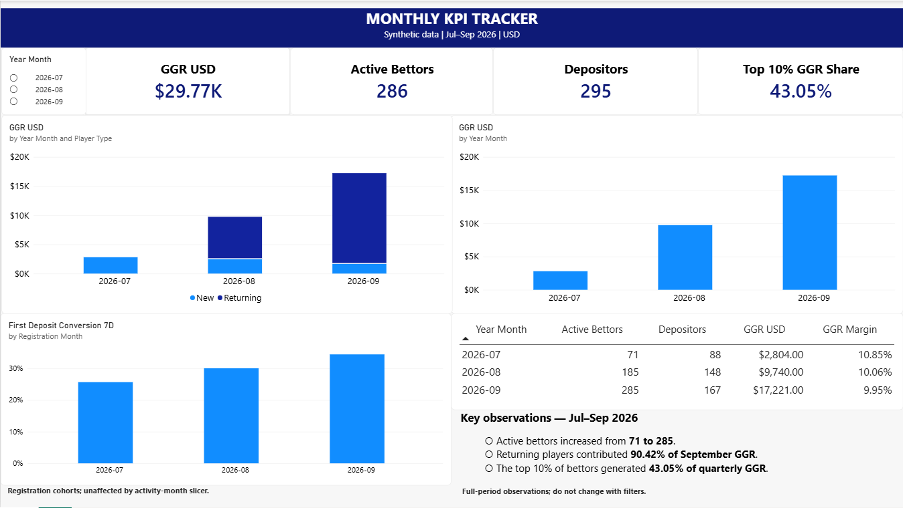

# iGaming Player Analysis

A small SQL portfolio project exploring player activity, first deposits and gaming revenue. The first version covers July–September 2026. Power BI is the next step and is not included yet.

All data is synthetic, generated for practice. It contains no employer or customer information and does not represent industry benchmarks.

## Questions

- How do active bettors, depositors and GGR change each month?
- What share of new registrations make their first deposit within seven days?
- How much GGR comes from new versus returning players?
- How concentrated is GGR among the highest-revenue players?

## Run it

Requires Python 3.8+ with SQLite 3.25+ (window functions). No third-party packages.

```bash
python build.py
```

This rebuilds `data/igaming.db` using random seed 42, executes the four SQL files and writes result tables to `results/`. Run from the extracted project folder. The database can also be opened in any SQLite-compatible SQL client. SQL uses SQLite date functions; it is not a MySQL or BigQuery script.

## Data

500 registered players, with 2,714 player-day activity records in the included run.

| Table | Grain | Main fields |
| --- | --- | --- |
| players | One row per player | player_id, registration_date, channel |
| deposits | One successful deposit | deposit_id, player_id, deposit_date, amount_cents |
| player_daily | One betting day per player | player_id, activity_date, rounds, stakes_cents, payouts_cents |

Amounts are integer US cents, converted to USD in the results. Dates are calendar dates with no time-zone conversion. Payouts are total amounts returned to the player, including the returned stake. Stakes and payouts settle on the same day in this simplified dataset.

## Metric choices

- **Active bettor:** a player with at least one settled round during the month.
- **Depositor:** a player with at least one successful deposit during the month. Depositors and bettors can differ.
- **GGR:** stakes minus payouts. Deposits are funding, not revenue.
- **GGR margin:** GGR divided by stakes.
- **Seven-day deposit conversion:** first deposit on registration day through day 6, divided by registrations with all seven days observed. September registrations after September 24 are excluded.
- **New / returning:** registered in the activity month / registered in an earlier month. This is registration-based, not first-bet-based.
- **Concentration:** share of signed quarterly GGR generated by the top 10% of active bettors ranked by GGR, rounding the player count up. Negative player GGR is retained.

NGR is not calculated: bonus costs, taxes and fees are not modelled.

## Initial observations

- Monthly GGR rises from $2,804 in July to $17,221 in September, while active bettors rise from 71 to 285. This is partly built into the simulation: the player base accumulates from a July launch with no prior players.
- GGR margin is fairly stable (10.85%, 10.06%, 9.95%). The generator uses a fixed, simplified payout model, so this is expected rather than a discovered operational improvement.
- Seven-day first-deposit conversion is 25.67%, 30.06% and 34.45% across the three registration cohorts. These small synthetic cohorts do not establish a real improvement or a channel effect.
- Returning players generate $15,571 of September's $17,221 GGR (90.42%). Their larger accumulated population should be considered before interpreting this as better player quality.
- The top 29 of 286 active bettors account for 43.05% of quarterly GGR. In a real analysis, I would check whether this concentration persists across months before drawing conclusions about revenue stability.

Detailed outputs are in `results/` and the corresponding logic is in `sql/`.

## Checks and limitations

The build checks database integrity, foreign keys, activity dates against registration and monthly stakes/payout totals against the source table. Each fact table is aggregated before joining to avoid duplicate revenue.

The generator tracks a simplified balance so betting cannot spend more than deposited funds plus winnings. It has no withdrawals, bonuses, failed payments, refunds, chargebacks, pending bets or currency conversion. Its fixed payout distribution, participation assumptions and short launch period limit realism. This project demonstrates SQL and metric reasoning, not commercial forecasting or causal analysis.

## Dashboard

Built in Power BI to track monthly GGR, active bettors,
depositors, GGR margin, new versus returning player revenue,
seven-day first-deposit conversion and revenue concentration.



The activity-month slicer filters the activity metrics.
The conversion chart uses registration cohorts and remains
unaffected by this slicer. Written observations cover the
full July–September period.